# Trabalho de Implementação — 2º período

**Engenharia de Software | Apresentação em 16/11/2026**

Projeto de estudo dos **nove algoritmos de ordenação em Python**, com código pequeno, explicação em linguagem simples e **animações ilustrativas de cada algoritmo**.

## Como executar no VS Code

1. Abra esta pasta no VS Code (Python 3 instalado).
2. Abra **Terminal > Novo Terminal**.
3. Execute:

```bash
python main.py
python testes.py
```

O programa cria **100.000 números aleatórios**, sempre com semente 42 para repetir o teste. **Merge, Quick, Heap, Counting, Radix e Bucket** executam os 100.000. **Selection, Bubble e Insertion** usam inicialmente 1.000 números por serem muito lentos com 100.000. Para forçar o teste completo em um deles:

```bash
python main.py --algoritmo selection --completo
```

**Aviso:** executar 100.000 itens nos algoritmos lentos pode demorar bastante. Não compare tempos de tamanhos diferentes.

## As 9 explicações animadas

As animações SVG abaixo são executadas automaticamente no visualizador de imagens compatível. Abra a imagem separadamente se ela não se mover no preview do GitHub.

### 1. Selection Sort

- **Como funciona:** Procura o menor e coloca na posição correta.
- **Vantagem:** Bem simples e poucas trocas.
- **Desvantagem:** Lento com muitas informações.
- [Abrir código Python](./selection_sort.py) · [Abrir animação](./animacoes/selection_sort.svg) · [Assistir ao vídeo MP4](./videos/selection_sort.mp4)



### 2. Bubble Sort

- **Como funciona:** Compara vizinhos e troca quando necessário.
- **Vantagem:** Muito fácil de entender.
- **Desvantagem:** Faz muitas comparações.
- [Abrir código Python](./bubble_sort.py) · [Abrir animação](./animacoes/bubble_sort.svg) · [Assistir ao vídeo MP4](./videos/bubble_sort.mp4)



### 3. Insertion Sort

- **Como funciona:** Insere cada número no lugar certo.
- **Vantagem:** Bom para listas pequenas.
- **Desvantagem:** Lento com listas grandes e misturadas.
- [Abrir código Python](./insertion_sort.py) · [Abrir animação](./animacoes/insertion_sort.svg) · [Assistir ao vídeo MP4](./videos/insertion_sort.mp4)



### 4. Merge Sort

- **Como funciona:** Divide em partes menores e junta ordenando.
- **Vantagem:** Rápido e previsível.
- **Desvantagem:** Usa memória extra.
- [Abrir código Python](./merge_sort.py) · [Abrir animação](./animacoes/merge_sort.svg) · [Assistir ao vídeo MP4](./videos/merge_sort.mp4)



### 5. Quick Sort

- **Como funciona:** Escolhe pivô e separa menores e maiores.
- **Vantagem:** Geralmente muito rápido.
- **Desvantagem:** Pior caso pode ser lento.
- [Abrir código Python](./quick_sort.py) · [Abrir animação](./animacoes/quick_sort.svg) · [Assistir ao vídeo MP4](./videos/quick_sort.mp4)



### 6. Heap Sort

- **Como funciona:** Usa um heap para levar o maior ao fim.
- **Vantagem:** Bom desempenho até no pior caso.
- **Desvantagem:** É mais difícil de acompanhar.
- [Abrir código Python](./heap_sort.py) · [Abrir animação](./animacoes/heap_sort.svg) · [Assistir ao vídeo MP4](./videos/heap_sort.mp4)



### 7. Counting Sort

- **Como funciona:** Conta quantas vezes cada número aparece.
- **Vantagem:** Rápido para intervalo pequeno.
- **Desvantagem:** Ocupa memória conforme o maior valor.
- [Abrir código Python](./counting_sort.py) · [Abrir animação](./animacoes/counting_sort.svg) · [Assistir ao vídeo MP4](./videos/counting_sort.mp4)



### 8. Radix Sort

- **Como funciona:** Organiza por unidade, dezena e centena.
- **Vantagem:** Bom para inteiros não negativos.
- **Desvantagem:** Tem restrições e usa memória extra.
- [Abrir código Python](./radix_sort.py) · [Abrir animação](./animacoes/radix_sort.svg) · [Assistir ao vídeo MP4](./videos/radix_sort.mp4)



### 9. Bucket Sort

- **Como funciona:** Separa em grupos, ordena e junta.
- **Vantagem:** Eficiente quando bem distribuído.
- **Desvantagem:** Depende de como os dados se distribuem.
- [Abrir código Python](./bucket_sort.py) · [Abrir animação](./animacoes/bucket_sort.svg) · [Assistir ao vídeo MP4](./videos/bucket_sort.mp4)




### Exemplos ilustrativos

Os vídeos usam listas curtas para tornar cada etapa visível. No **Bucket Sort**, mostramos cinco faixas didáticas; o código define automaticamente a quantidade de baldes conforme o tamanho da entrada. As animações são demonstrações conceituais; o cronômetro do `main.py` mede os algoritmos reais.

## Comparação rápida

| Algoritmo | Custo típico | Característica |
|---|---|---|
| Selection | O(n²) | muitas comparações |
| Bubble | O(n²) | compara vizinhos |
| Insertion | O(n²) | insere no lugar certo |
| Merge | O(n log n) | divide e intercala |
| Quick | O(n log n) médio | escolhe pivô |
| Heap | O(n log n) | heap máximo |
| Counting | O(n + k) | conta ocorrências |
| Radix | O(d · (n + 10)) | ordena por dígitos |
| Bucket | depende dos baldes | agrupa e ordena |

**Observação:** as versões apresentadas de Counting, Radix e Bucket trabalham com inteiros não negativos.

## Roteiro curto para apresentação

> Criamos nove formas diferentes de ordenar números. O programa gera 100 mil números aleatórios e compara os tempos. Os algoritmos mais simples ajudam a entender lógica, mas ficam lentos com grandes listas. Outros usam divisão, pivôs, estruturas ou contagens para trabalhar mais rápido. A escolha depende do tamanho e do tipo dos dados.

## Arquivos

- `selection_sort.py` até `bucket_sort.py`: nove implementações com vantagens/desvantagens em comentários.
- `main.py`: gera dados, cronometra e valida os resultados.
- `testes.py`: verifica os nove algoritmos sem modificar a entrada.
- `animacoes/`: nove SVG animados, um por algoritmo.
- `videos/`: vídeos MP4 gerados automaticamente por uma rotina de documentação.
- `ferramentas/gerar_videos.py`: gerador **opcional**, não necessário para executar o trabalho.

**Repositório:** [Videirafoo/Videirafoo](https://github.com/Videirafoo/Videirafoo) · [Voltar à página do perfil](../../)
